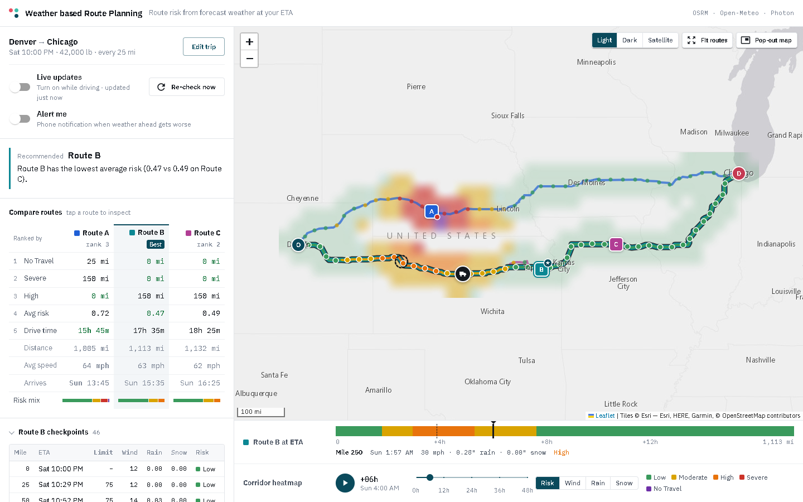
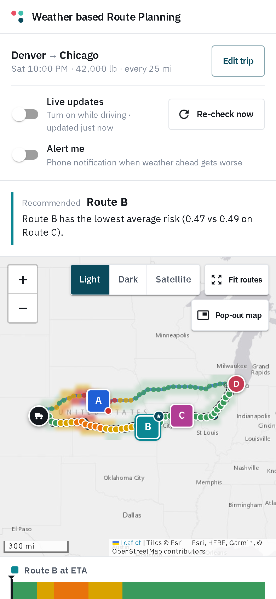

# Weather-Aware Truck Routing

A web app that helps a truck driver pick the **safest route** between two places. It weighs the **weather the truck will actually meet** at each point on the way (forecast for the hour it gets there), the **load weight**, and the **travel time**.

Built with **React + TypeScript** (frontend) and **Django + Django REST Framework** (backend).

- **Live app:** [spotter-truck-routing-15e6.onrender.com](https://spotter-truck-routing-15e6.onrender.com)
- **Walkthrough video:** _add your Loom link here_

| Desktop | Phone |
|---|---|
|  |  |

<sub>The screenshots use a simulated storm over the Plains so every risk level is visible. With calm real weather, all routes show Low.</sub>

---

## Contents

1. [What it does](#what-it-does)
2. [Beyond the brief: what we added](#beyond-the-brief-what-we-added)
3. [Using the app in your browser](#using-the-app-in-your-browser)
4. [Running it locally](#running-it-locally)
5. [How the system works](#how-the-system-works)
6. [What's used (tech stack and services)](#whats-used)
7. [Architecture and code layout](#architecture-and-code-layout)
8. [API reference](#api-reference)
9. [Testing](#testing)
10. [Deployment](#deployment)
11. [Requirements checklist](#requirements-checklist)
12. [Assumptions, trade-offs and limitations](#assumptions-trade-offs-and-limitations)

---

## What it does

1. **You enter a trip:** origin and destination, departure time, load weight, and how often to check the weather (every **10, 25 or 50 miles**).
2. **It finds three route options** between the two points.
3. **It places a checkpoint every N miles** on each route and works out the truck's **ETA** at each one.
4. **It fetches the forecast for that exact hour** at each checkpoint (wind, rain, snow) and classifies the risk with the rules below, including the load-weight rules.
5. **It recommends a route,** ranking by fewest Severe miles, then fewest High miles, then lowest average risk, then shortest travel time. It tells you *why* in plain language.
6. **It shows everything on a map:**
   - all three routes, the selected one coloured by risk mile by mile
   - every checkpoint, with its ETA, weather and risk
   - a summary label on each route
   - a **weather heatmap along the trip corridor** with a **0–48 hour forecast slider**
7. **Live updates (driving mode):** while you drive, the app re-plans from your phone's GPS position every 15 minutes, using fresh forecasts. It tells you if conditions ahead got worse or better.

### Risk rules

Each checkpoint takes the **worst** of its wind, rain and snow levels:

| Condition | Low | Moderate | High | Severe | No Travel |
|---|---|---|---|---|---|
| Wind | < 25 mph | 25–34 | 35–44 | 45–54 | ≥ 55 mph |
| Rain | < 0.10 in/hr | 0.10–0.25 | 0.25–0.50 | 0.50–1.00 | > 1.00 |
| Snow | < 0.5 in/hr | 0.5–1.0 | 1.0–2.0 | 2.0–3.0 | > 3.0 |

Then the **load rules** are applied. The mph here is **wind speed**, not driving speed: heavy trailers are what high crosswinds push around or tip. They can only *raise* the risk:

- Wind ≥ 55 mph → **No Travel** for any load
- Wind 45–54 mph with load **> 30,000 lb** → **No Travel**
- Wind 35–44 mph with load **> 40,000 lb** → **Severe**

**Load weight is part of every safety decision.** These rules run at **every checkpoint on every route** and in **every cell of the heatmap**. So the same weather can be High for a 35,000 lb load and Severe for a 45,000 lb one, and that changes the Severe/High miles, the ranking, and the recommended route. The thresholds are tested at their exact edges (30,000 vs 30,001 lb; 40,000 vs 40,001 lb), and each checkpoint explains itself, e.g. *"45,000 lb load in 40 mph wind (> 40,000 lb at 35–44 mph) → Severe"*.

---

## Beyond the brief: what we added

The PDF asks for: three routes from a routing API, weather sampled every 10/25/50 miles at the truck's ETA, risk from the table and load rules, a recommendation (Severe → High → average risk → time), routes/checkpoints/risk/ETAs/summaries on a map, and a corridor heatmap with a 0–48 h slider. **All of that is done**; see the [checklist](#requirements-checklist).

Everything below goes **beyond the brief**. It was built around the real user: **a truck driver, usually on a phone, often with weak signal, whose weather changes while they drive.**

### Safer, more realistic risk and timing

| Added | What it does | Where |
|---|---|---|
| **Posted speed limits in ETAs** | Each route is checked against real posted limits (OpenStreetMap via Valhalla, ~98–100% coverage on interstates). Highways are driven at the lower of the posted limit and the truck's governed speed (65 mph default), and other roads never above their limit. On Denver→Chicago this moved the ETA by ~2 h versus a flat cap, which changes which forecast hour each checkpoint is checked against. | `speed_limits.py` |
| **State truck speed limits** | States like **California (55 mph)**, **Oregon (55)** and **Washington (60)** cap trucks below the posted limit statewide, by law. Each road segment is placed in its state (Census boundaries) and capped accordingly, with statute citations in the rule table. Works even when posted-limit lookups are unavailable. | `truck_rules.py`, `data/state_boundaries.json` |
| **Truck speed cap** | A loaded truck never drives faster than its governed speed (`TRUCK_MAX_SPEED_MPH`). | `routing.py`, `speed_limits.py` |
| **"No Travel" ranked first** | The brief doesn't rank No Travel; a route you can't safely drive should never win just because it has fewer Severe miles. | `recommendation.py` |
| **Mileage-true risk** | Each checkpoint represents the road halfway to its neighbours, so "Severe miles" is real road distance, including a short final interval. | `planner.py` |
| **Explained risk** | Every checkpoint says *why*: *"45,000 lb load in 40 mph wind (> 40,000 lb at 35–44 mph) → Severe"*. The recommendation names the deciding criterion. | `risk.py`, `recommendation.py` |
| **Better route alternatives** | OSRM returns only 1–2 routes, so via-point alternatives are generated and filtered for near-duplicates, absurd detours and out-and-back "spurs" (a local-optimality check). | `routing.py` |
| **Precise risk boundaries** | Band edges follow the table exactly (`≥ 55` for wind but `> 1.00` / `> 3.0` for rain and snow; 30,000 vs 30,001 lb), and all are tested. | `risk.py`, tests |

### Built for drivers on the road

| Added | What it does | Where |
|---|---|---|
| **Live updates from GPS** | Every 15 minutes (and when you come back to the app) it re-plans from the truck's position with fresh forecasts, then shows whether conditions ahead got **worse or better**. It keeps the screen awake while driving. | `useTripSession.ts`, `live.ts` |
| **Risk alerts** | With *Alert me* on, the phone gets a system notification when the weather ahead gets worse; tapping it opens the app. | `notify.ts`, `sw.js` |
| **Pop-out map over other apps** | A mini map floats over Google Maps or any other app (Picture-in-Picture), with real map tiles, the risk-coloured route, the truck, and the next hazard, e.g. *"High in 24 mi, at 15:10"*. | `floating.ts` |
| **Installable app (PWA)** | Add to home screen; opens full-screen with its own icon, like a native app. | `manifest.webmanifest`, `sw.js`, `pwa.ts` |
| **Works offline** | With no signal the app still opens with the **last trip** (routes, checkpoints, heatmap) and the map areas already viewed. Live updates pause and resume on reconnect. | `sw.js`, `savedTrip.ts`, `useOnline.ts` |
| **Mobile-first, few steps** | On phones the recommendation comes first, then the map and slider. The trip form collapses to one line. Finger-sized controls; **My location**; one-tap departure times (Now, +1 h, +3 h, Tomorrow 6 AM); load and interval remembered. Layouts for phone, tablet portrait and tablet landscape. | `styles.css`, `TripForm.tsx`, `App.tsx` |

### A clearer map and UI

| Added | What it does | Where |
|---|---|---|
| **Weather along the route strip** | The selected route as a risk-coloured bar by mile with ETA ticks. Touch or hover it to see weather at that spot, highlighted on the map, with a marker for the truck at the slider's hour. | `RouteProfile.tsx` |
| **Route comparison table** | The three routes side by side in ranking order, with each row's winner highlighted and an average truck speed row. | `RouteComparison.tsx` |
| **Smooth, accurate heatmap** | A Mercator-aligned grid painted as one image overlay, so there's no overlap distortion and no reprojection error. All 49 hours are pre-rendered, so the slider never waits on the network. Risk, wind, rain and snow layers. | `heatmap.py`, `heatmapImage.ts` |
| **Truck on the timeline** | Moving the slider moves a truck marker along the route to where you'd be at that hour. | `geo.ts`, `MapView.tsx` |
| **Light / dark / satellite maps** | Dark for night driving, satellite for terrain; the choice is remembered. | `basemaps.ts` |
| **Speed limits on screen** | Every checkpoint shows the limit a truck must obey (marked when a state truck limit is lower than the posted one). | `CheckpointList.tsx` |

### Reliability and scale

| Added | What it does | Where |
|---|---|---|
| **Free-tier rate-limit resilience** | Open-Meteo throttles shared cloud IPs, so the browser fetches the forecast with its own quota while the server keeps all the logic. Includes a circuit breaker, caching, and retries with backoff. | `weather.py`, `client.ts` |
| **Non-blocking speed-limit lookups** | Plans never wait on the free speed-limit server. Lookups run in the background (2 at a time, backing off on 429), limits are cached by location and direction so any route on the same roads reuses them, and failures cool down. | `speed_limits.py` |
| **Stateless, horizontally scalable API** | Any instance can serve any request; Redis is optional for a shared cache; DRF throttling protects upstream quotas. | `settings.py` |
| **Resilient caching** | Cache errors are treated as misses, never as failed requests. | `cache.py` |
| **One-container deploy** | Django serves the API and the built React app; Render blueprint included. | `Dockerfile`, `render.yaml` |

### Engineering

- **Tests:** **107 backend tests** cover risk boundaries, ranking, ETAs, speed-limit and state-truck rules, providers, offline fallback and the API. **17 frontend tests** cover heatmap colours, truck position, live-change detection, next hazard, the saved trip and tile projection.
- **Pure, typed domain logic:** risk, ranking and geometry have no I/O; the frontend is strict TypeScript.
- **Thin providers:** every external service sits behind one small module, so routing, weather, speed limits or geocoding can each be swapped independently.

---

## Using the app in your browser

Open **[spotter-truck-routing-15e6.onrender.com](https://spotter-truck-routing-15e6.onrender.com)**. It works on phones, tablets and desktops.

> The free hosting tier sleeps when idle, so the first load after a while can take 30–60 seconds.

1. **From / To:** type a city or address and pick a suggestion, or tap **My location** to use your GPS. Raw coordinates (`39.74,-104.99`) work too. **⇅** swaps the two.
2. **Departure:** tap a quick choice (**Now**, **+1 h**, **+3 h**, **Tomorrow 6 AM**) or pick a date and time. Any time up to 7 days ahead works.
3. **Load:** gross load in pounds. It's remembered for next time.
4. **Check weather every:** 10, 25 or 50 miles. Also remembered.
5. Tap **Find safest route.**

**Reading the results**

- **Recommended:** the best route, with one sentence explaining what decided it.
- **Map:**
  - The selected route is drawn in its colour, with the road itself coloured by risk.
  - Each route has a label with drive time, distance and Severe miles.
  - Tap a checkpoint dot (or hover on desktop) for its ETA, wind, rain, snow and why it got its risk level.
  - Tap another route to select it.
  - **Light / Dark / Satellite** switches the base map; **Fit routes** re-centres.
- **Route at ETA strip:** the selected route laid out by mile, coloured by risk, with hour ticks. Touch or hover it to inspect a stretch; the map highlights that spot. ▼ marks the truck at the slider's hour.
- **Corridor heatmap:** drag the slider (0–48 h after departure) or press ▶ to animate. Switch between **Risk / Wind / Rain / Snow**. The truck marker moves along the route to show where you'd be at that hour.
- **Compare routes:** the three routes side by side, in the same order they're ranked. The best value in each row is highlighted.
- **Checkpoints:** the full table for the selected route. Tap a row to jump to it on the map.

**While driving**

- **Live updates:** re-checks from your GPS position every 15 minutes, and immediately when you come back to the app after 5+ minutes away. It keeps the screen awake where the browser supports it, and a banner tells you if the weather ahead got worse or better. **Re-check now** does it on demand.
- **Alert me:** allow notifications and the phone alerts you when the weather ahead gets worse.
- **Pop-out map:** floats a mini map with the next hazard over other apps, so you can keep Google Maps or your dispatch app in front. Supported in Chrome on Android and desktop, Edge, and Safari on macOS.

**Install it like an app**

- **Android (Chrome):** tap **Install app** in the top bar (or ⋮ → *Install app*).
- **iPhone (Safari):** Share → *Add to Home Screen*. Notifications on iPhone need the installed app (iOS 16.4+).
- **Desktop (Chrome/Edge):** the install icon in the address bar, or **Install app**.

**No signal?** The app still opens and shows your last trip (routes, checkpoints, heatmap and the map areas you've viewed), with a banner saying it's offline. Planning a new trip needs a connection; live updates resume automatically when you're back online.

---

## Running it locally

### Requirements

- **Python 3.11+** (developed on 3.13)
- **Node.js 20+** (developed on 24)
- No API keys and no database setup. All external services used are free and keyless.

### 1. Backend (Django API on http://127.0.0.1:8000)

```bash
cd backend
python -m venv .venv

# macOS / Linux
source .venv/bin/activate
# Windows (PowerShell)
.venv\Scripts\Activate.ps1

pip install -r requirements-dev.txt
python manage.py runserver
```

Check it: <http://127.0.0.1:8000/api/health/> should return `{"status": "ok"}`.

### 2. Frontend (React app on http://localhost:5173)

In a second terminal:

```bash
cd frontend
npm install
npm run dev
```

Open **http://localhost:5173**. The Vite dev server proxies `/api` to the Django server, so nothing else needs configuring.

### 3. Optional: run it as the production build (one server)

```bash
cd frontend && npm run build
# copy the build next to Django, which serves it at "/"
cp -r dist ../backend/frontend_dist            # Windows: xcopy /E /I dist ..\backend\frontend_dist
cd ../backend
DJANGO_DEBUG=false python manage.py collectstatic --noinput
DJANGO_DEBUG=false python manage.py runserver   # open http://127.0.0.1:8000
```

Or with Docker:

```bash
docker build -t truck-routing .
docker run -p 8000:8000 -e DJANGO_SECRET_KEY=change-me truck-routing
# open http://localhost:8000
```

### Configuration (all optional)

Everything has a sensible default; see [`.env.example`](.env.example).

| Variable | Default | Purpose |
|---|---|---|
| `DJANGO_DEBUG` | `true` | Set `false` in production |
| `DJANGO_SECRET_KEY` | dev key | Required in production |
| `DJANGO_ALLOWED_HOSTS` | `localhost,127.0.0.1,.onrender.com` | Hostnames Django serves |
| `REDIS_URL` | – | Shared cache across instances (otherwise a per-instance file cache) |
| `WEATHER_SOURCE` | `auto` | `auto`, `server` or `client`; see [rate limits](#weather-and-the-free-tier-rate-limit) |
| `OSRM_URL` | public OSRM | Point at a self-hosted OSRM |
| `PHOTON_URL` | public Photon | Point at a self-hosted Photon |
| `OPEN_METEO_API_KEY` | – | Use Open-Meteo's commercial tier |
| `TRUCK_MAX_SPEED_MPH` | `65` | Truck's governed (top) speed |
| `SPEED_LIMITS_ENABLED` | `true` | Use posted speed limits in ETAs |
| `VALHALLA_URL` | public Valhalla | Point at a self-hosted Valhalla for speed limits |
| `API_RATE_LIMIT` | `120/min` | Per-client API throttle |
| `VITE_API_URL` | same origin | Frontend build-time: API on another host |
| `VITE_TILE_URL` | Esri light gray | Frontend build-time: custom base map tiles |

---

## How the system works

```
Browser (React)                              Django API (stateless)                   Free services
───────────────                              ──────────────────────                   ─────────────
Trip form ──POST /api/plan/──────────────▶   validate → geocode ─────────────────▶   Photon
                                             3 routes ───────────────────────────▶   OSRM
                                             checkpoints + ETAs
                                             forecast at each ETA ───────────────▶   Open-Meteo
                                             risk rules + load rules
                                             rank + explain
           ◀── routes, checkpoints, summary, recommendation, corridor
Map renders routes immediately
           ──POST /api/heatmap/ (corridor)──▶ corridor grid × 49 hourly frames ──▶   Open-Meteo
           ◀── frames
Slider scrubs pre-rendered frames (no network)
```

### 1. Three route options

OSRM's built-in alternatives usually return only 1–2 routes. To always offer three *real* choices, the backend also routes through **via-points** pushed sideways from the straight origin→destination line, in parallel rounds of three. A candidate is kept only if it passes three checks:

- **Not a near-duplicate:** less than 80% of it may lie within 1.5 mi of a route already chosen.
- **Not an absurd detour:** at most 1.6× the fastest route's time.
- **Locally sensible around the via-point:** the ±10% stretch of trip (25–75 mi) around the via-point may be at most 1.25× the fastest road between its ends. This rejects routes that drive down a side road to the via-point and straight back.

### 2. Checkpoints and ETAs

- Checkpoints sit at mile 0, N, 2N, … and at the destination.
- The ETA at each one comes from **per-road-segment travel times along the real road geometry**, not an average speed. Each segment is timed as a truck would drive it, using the road's **posted speed limit** (see [Posted speed limits](#posted-speed-limits)).
- Each checkpoint **represents the road halfway to its neighbours**, so "Severe miles" adds up to real road distance, and a short final interval is weighted correctly.

### Posted speed limits

The ETA decides which forecast hour each checkpoint is checked against, so it should reflect how a truck actually drives the road.

1. **Look up the limits.** Each route is map-matched against **Valhalla** (`trace_attributes`, the public OpenStreetMap instance), which returns the posted limit and road class for every stretch. Coverage on US interstates is ~98–100%.
2. **Time each segment as a truck:**
   - **Motorway / trunk:** the lower of the posted limit and the truck's **governed speed** (`TRUCK_MAX_SPEED_MPH`, default 65; most fleet trucks are speed-limited). A 75 mph interstate is driven at 65, a 55 mph stretch at 55.
   - **Other roads:** OSRM's estimate, which includes turns and intersections, but never faster than the posted limit or the governed speed.
   - **No limit known:** OSRM's estimate capped at the governed speed.
3. **State truck limits on top.** Some states cap trucks below the posted limit statewide, by statute, and map data rarely tags this per road. `truck_rules.py` places every segment in its state (US Census 2010 boundaries, simplified to ~1 km) and lowers the cap:

   | State | Truck limit | Source |
   |---|---|---|
   | California | 55 mph | Vehicle Code §22406 |
   | Oregon | 55 mph | ORS 811.111 (some I-84 sections allow 60–65; not modelled, so conservative) |
   | Washington | 60 mph | RCW 46.61.410 |
   | Michigan | 65 mph | MCL 257.627 |
   | Indiana | 65 mph | IC 9-21-5-2 |

   Only states whose truck limit can bind at a typical governed speed are listed. The table is data; verify it against current statutes before relying on it, and extend it as needed. Rules assume a loaded tractor-trailer, which is above every state's weight threshold.
4. **Show them:** each checkpoint shows the limit a truck must obey, marked when a state truck limit is lower than the posted one, and each route its average truck speed.

**Fast and polite to a free server.** The public Valhalla server allows ~1 request/second and 200 km per request, so a cross-country trip needs many lookups.
- **Spatial cache:** limits are cached by **map cell (~500 m) and direction of travel**, not per route. Any later route over the same roads (the other options, live re-checks from GPS, other users) reuses them without calling Valhalla.
- **Plans never wait:** a plan uses what's already known, and missing stretches are fetched **in the background**, 2 at a time, backing off on 429. The plan reports `speed_limits: "pending"`, and the app quietly re-plans a few seconds later to pick up the refined ETAs. The heatmap isn't refetched, because it doesn't depend on ETAs.
- **Failures cool down** for 5 minutes, and ETAs fall back to the capped OSRM estimate, so planning never breaks if the service is down.

### 3. Weather at the ETA

- Source: Open-Meteo hourly forecast.
  - `wind_speed_10m` in mph.
  - `rain + showers` (stratiform plus convective) in in/hr.
  - `snowfall` in in/hr.
- Precipitation values are the total for the preceding hour, which is already a per-hour rate.
- Each checkpoint uses the forecast hour **nearest its ETA**.
- Locations are snapped to a 0.05° grid (~5 km, about the forecast models' resolution), so overlapping routes share lookups.
- Up to 100 locations go in one request, with requests running in parallel, and results are cached for 30 minutes.

### 4. Risk classification

[`risk.py`](backend/trips/services/risk.py) holds the table above as data.

- **Band edges:** each band's lower bound is inclusive. For example, 34.9 mph is Moderate and 35.0 mph is High.
- **Top band, as the spec writes it:** "≥ 55 mph" for wind, but "> 1.00" and "> 3.0" for rain and snow. So exactly 1.00 in/hr of rain is Severe, not No Travel.
- **Load rules:** applied after the weather bands, and they never lower the risk.
- **Reasons:** every checkpoint records why it got its level, e.g. *"45,000 lb load in 40 mph wind (> 40,000 lb at 35–44 mph) → Severe"*.

### 5. Recommendation

Routes are sorted by:

```
(No Travel miles, Severe miles, High miles, mileage-weighted average risk, travel time)
```

This is exactly the spec's order (**Severe → High → average risk → time**), with **No Travel miles added in front**. The spec doesn't rank No Travel, but a route that can't be driven safely must never win just because it has fewer Severe miles.

- **Average risk** scores Low=0, Moderate=1, High=2, Severe=3, No Travel=4, weighted by the miles each checkpoint represents.
- **Rounding:** miles to 0.1 and average risk to 0.01, so float noise never overrides a real difference further down.
- **Explanation:** the UI names the criterion that decided it, e.g. *"Route B has the fewest Severe miles (0 mi vs 150 mi on Route A)"*.
- **Every route has No Travel miles:** the explanation suggests delaying departure.

### 6. Corridor heatmap (and why it's smooth)

- **The grid:** the backend lays a grid over an **80-mile-wide corridor** around all three routes. It holds at most 300 forecast locations, with cell size adapting to trip length.
- **The data:** it returns **all 49 hourly frames** (0–48 h after departure) for risk, wind, rain and snow in one gzipped response, which loads *after* the routes so the map appears first.
- **No reprojection error:** grid rows are spaced evenly in Web-Mercator Y, so the browser can paint **one pixel per cell** onto a tiny canvas, upscale it with bilinear smoothing, and lay it on the map as a single image overlay.
  - Unlike point-based heat layers, values are never summed where points overlap, so the colours stay faithful to the risk table.
- **Instant slider:** all 49 frames are rendered to images once and cached per layer. Moving the slider swaps one image source, with no network calls and no map re-render.

### 7. Live updates

Weather moves, so a plan made at departure goes stale. With **Live updates** on, the browser does three things:

- Every 15 minutes, and whenever the app returns to the foreground after 5+ minutes, it reads the GPS position and **re-plans from there to the same destination**. Departure is *now*, with the same load and interval, so every checkpoint ahead is re-evaluated against current forecasts.
- It compares the new recommendation with the previous one and shows a banner: **worse** (higher worst level, or more Severe or High miles beyond a 5-mile noise margin), **better**, or **no change**.
- It requests a screen wake lock so a mounted phone stays on.

If GPS is unavailable, it refreshes the forecasts from the original start and says so.

### 8. Installable app and offline mode

- **Web App Manifest** (`manifest.webmanifest`): name, icons (including a maskable icon for Android) and theme colour, opening `standalone` so it looks like a native app.
- **Service worker** (`public/sw.js`), only in production builds:

  | Request | Strategy |
  |---|---|
  | The page | network first, cached copy when offline |
  | Hashed `/assets/*` | cache first (names change whenever content changes) |
  | Esri map tiles | cache first, capped at 800 tiles; Esri sends CORS headers, so tiles are cached as real responses rather than opaque ones |
  | Fonts | stale-while-revalidate |
  | `/api/*` | never cached by the worker |

- **First visit:** the page sends the worker the asset URLs it already loaded, so offline works from the very first visit.
- **The trip itself** (plan, request and heatmap, about 250 KB) is saved in `localStorage` after every plan and restored on startup, for up to 3 days. A banner says whether you're seeing a saved trip or are offline.

### 9. Risk alerts

When a live re-check finds the weather ahead got worse and **Alert me** is on, the app shows a system notification through the service worker.
- Alerts use one `tag`, so a new alert replaces the previous one instead of stacking.
- Tapping the notification brings the app back to the front.
- No account or push server is needed. See the [limitations](#assumptions-trade-offs-and-limitations) for alerts while the app is fully closed.

### 10. Pop-out map

Browsers can't draw over other apps directly, but a `<video>` can go **Picture-in-Picture**. `floating.ts` does the rest:
- It paints a 480×270 canvas every second: real basemap tiles (CORS), the risk-coloured route, the truck at its current position, a header with the **next hazard ahead** ("High in 24 mi, at 15:10, Rain 0.31 in/hr"), and a progress strip.
- It streams the canvas into a hidden video (`canvas.captureStream`) and floats that video.
- The truck position comes from the plan's checkpoint ETAs. In live mode the plan starts at the GPS position, so it tracks the real truck.

### Weather and the free-tier rate limit

Open-Meteo's free tier limits requests **per IP address**, and free cloud hosts (including Render) share outbound IPs between many apps, which quickly exhausts the limit. The system handles this without paid keys:

- When the server is rate-limited, the API responds with a `weather_request`: the exact Open-Meteo query it needs.
- The **browser runs that query using the user's own IP and quota,** then repeats the API call with the raw hourly data attached.
- **All parsing, risk rules and ranking still run on the server.** The browser only fetches the data, and the server validates what it receives.
- `WEATHER_SOURCE`:
  - `auto` (default): server first, with a 10-minute circuit breaker that switches to the browser while rate-limited.
  - `server`: always fetch on the server.
  - `client`: always let the browser fetch. Set in `render.yaml`.
- The browser caches forecasts per location and time window and retries with backoff (1.5 s, then 4 s), so replans don't refetch.

---

## What's used

### Frontend

| | |
|---|---|
| **React 18 + TypeScript** | UI, strict typing end to end |
| **Vite 5** | Dev server (with `/api` proxy) and production build |
| **Leaflet + react-leaflet** | Map, canvas-rendered routes and checkpoints, image overlay for the heatmap |
| **Esri tiles** | Light, dark and satellite base maps, keyless and CDN-backed |
| **IBM Plex Sans / Mono** | Type; tabular numbers for times and distances |
| **Vitest** | Unit tests for the pure helpers |
| **Service Worker + Web App Manifest** | Installable PWA, offline app shell and tile cache |
| **Browser APIs** | Geolocation (GPS), Notifications, Picture-in-Picture + `canvas.captureStream` (pop-out map), Screen Wake Lock, `localStorage` (saved trip) |

### Backend

| | |
|---|---|
| **Django 5.2 + Django REST Framework** | API, validation (serializers), throttling, error handling |
| **requests + urllib3 Retry** | Pooled HTTP sessions with retries, backoff and timeouts |
| **Django cache** | Redis when `REDIS_URL` is set, otherwise a resilient file cache shared by workers |
| **WhiteNoise** | Serves the built React app and static files from Django |
| **gunicorn** (threaded workers) | Production server; requests are I/O-bound |
| **pytest + pytest-django** | Test suite |

### External services (free, no API keys)

| Need | Service |
|---|---|
| Routing | [OSRM](https://project-osrm.org/) public server |
| Posted speed limits | [Valhalla](https://valhalla.github.io/valhalla/) public server (OpenStreetMap `maxspeed`) |
| State boundaries (truck rules) | US Census Bureau 2010 cartographic boundaries (public domain), bundled |
| Weather | [Open-Meteo](https://open-meteo.com/) hourly forecast API |
| Geocoding / autocomplete | [Photon](https://photon.komoot.io/) (OpenStreetMap data) |
| Base maps | Esri World Light Gray / Dark Gray / Imagery |

### Hosting

**Render** (free tier) runs a single Docker service built from [`Dockerfile`](Dockerfile) and configured by [`render.yaml`](render.yaml).

---

## Architecture and code layout

```
backend/                       Django 5 + DRF (stateless API)
  config/settings.py           12-factor settings (everything from env vars)
  trips/
    views.py                   thin API views
    serializers.py             input validation (incl. browser-supplied weather)
    exceptions.py              provider failures → 502 with a readable message
    cache.py                   best-effort file cache (I/O errors = cache miss)
    services/
      risk.py                  risk table + load rules           (pure, no I/O)
      recommendation.py        ranking + explanation             (pure)
      geo.py                   distances, interpolation, simplification, Mercator (pure)
      planner.py               routes → checkpoints/ETAs → weather → risk → ranking
      heatmap.py               corridor grid + 49 hourly frames
      routing.py               OSRM client + via-point alternatives
      speed_limits.py          posted limits (Valhalla), spatial cache, truck segment timing
      truck_rules.py           state truck speed limits (CA 55, OR 55, WA 60, …) + point-in-state
    data/state_boundaries.json simplified boundaries for the truck-rule states
      weather.py               Open-Meteo client, batching, caching, browser fallback
      geocoding.py             Photon client
      http.py                  shared HTTP session: pooling, retries, timeouts
    tests/                     pytest suite

frontend/                      React + TypeScript + Leaflet (Vite)
  src/
    App.tsx                    layout and state wiring (incl. live mode)
    api/                       typed client (+ browser weather fetch) and response types
    hooks/
      useTripSession.ts        the trip: planning, live re-checks, alerts, saved trip, online state
      useTripPlan.ts           useTripPlan / useHeatmap (abortable, race-safe)
      useMediaQuery.ts, useOnline.ts
    lib/
      risk.ts, heatmapImage.ts, geo.ts      colours, heatmap rasteriser, route geometry
      live.ts                  change detection, miles driven, next hazard ahead
      floating.ts              Picture-in-Picture mini map
      savedTrip.ts, pwa.ts, notify.ts, location.ts, prefs.ts, basemaps.ts
    components/                TripForm, TripSummary, LiveBar, RouteComparison, RouteProfile,
                               MapView, ForecastBar, CheckpointList, ...
  public/
    sw.js                      service worker (offline shell, tile cache, notification clicks)
    manifest.webmanifest, icons/
    styles.css                 one stylesheet; desktop, tablet and phone layouts

Dockerfile                     Node build stage → Python image serving API + SPA
render.yaml                    Render blueprint
```

**Design principles**

- **Pure domain logic.** The rules (`risk`, `recommendation`, `geo`) have no I/O, so they're unit-tested directly and can't be broken by an API change.
- **Thin providers.** Each external service sits behind one small module, so swapping one (e.g. a truck-specific routing API) doesn't touch the rules.
- **Stateless API.** The heatmap request carries its own corridor, so any instance can serve any request and the service scales horizontally.
- **Fast first paint.** Routes render as soon as they're ready, the heatmap streams in after, and slider frames are pre-rendered.
- **Mobile first for drivers.** On phones and portrait tablets, results lead with the recommendation, then the map and slider. The trip form collapses into one line, and controls are finger-sized.

---

## API reference

| Method | Path | Body / query | Returns |
|---|---|---|---|
| GET | `/api/health/` | – | `{"status": "ok"}` |
| GET | `/api/geocode/?q=Denver` | `q`: text | `{"results": [{"label", "lat", "lon"}]}` |
| POST | `/api/plan/` | see below | routes, checkpoints, summaries, recommendation, corridor |
| POST | `/api/heatmap/` | `{corridor, departure_time, load_weight_lb}` | grid + hourly frames for risk/wind/rain/snow |

Example `POST /api/plan/` body:

```json
{
  "origin": "Denver, CO",
  "destination": { "label": "Chicago, IL", "lat": 41.8756, "lon": -87.6244 },
  "departure_time": "2026-10-24T08:00:00-06:00",
  "load_weight_lb": 42000,
  "interval_miles": 25
}
```

- `origin` / `destination`: free text (geocoded on the server) or `{label, lat, lon}`.
- `departure_time`: must include a timezone offset and be within the next 7 days.
- `interval_miles`: one of 10, 25, 50.
- **Weather fallback:** either endpoint may answer `{"weather_request": {...}}`. The client fetches that query and repeats the same request with a `weather` field. The bundled frontend does this automatically.
- **Errors:** `400` with per-field messages for invalid input, `502` with a readable message when an upstream service fails.

---

## Testing

```bash
cd backend && pytest            # 107 tests
cd frontend && npm test         # 17 tests
cd frontend && npm run typecheck
```

What's covered:

- **Risk rules:** every band boundary for wind, rain and snow (including `≥` vs `>` at the top), and all load rules at their exact thresholds (30,000 / 30,001 lb, 40,000 / 40,001 lb).
- **Recommendation:** each ranking criterion and its tie-breakers, No Travel ordering, float-noise rounding, explanation text.
- **State truck limits:** state lookup (including border cases like Portland, OR vs Vancouver, WA), California trucks at 55 on a 70 mph freeway, rules applied even without posted limits.
- **Speed limits:** the truck timing rule for every road type, mapping matched edges onto route miles, spatial reuse by differently sampled routes, background (non-blocking) lookups, failure cooldown, chunking under service limits.
- **Planner:** checkpoint placement, ETAs from uneven segment speeds, mile coverage with a partial last interval, weather sampled at the ETA hour, risk-coloured route segments.
- **Providers (HTTP mocked):** OSRM parsing and the truck speed cap, via-point alternatives, spur rejection, Open-Meteo unit conversion, batching and caching.
- **Browser weather fallback:** client/auto/server modes, the circuit breaker, validation of browser-supplied data, cache I/O errors treated as misses.
- **API:** validation errors, geocoding free text, 502 on provider failure, the weather-request handshake.
- **Frontend:** heatmap colour scales and rasteriser, truck position along the route, live-update change detection, next hazard ahead and miles driven, saved-trip round-trip and expiry, map tile projection.

---

## Deployment

The app ships as **one Docker image**: a Node stage builds the React app, then the Python image runs gunicorn, with Django serving both the API and the built app (via WhiteNoise).

**Render (what the live app uses)**

1. Push the repo to GitHub.
2. In Render: **New → Blueprint**, select the repo. [`render.yaml`](render.yaml) creates the web service, generates `DJANGO_SECRET_KEY`, and sets `WEATHER_SOURCE=client`.
3. Every push to `main` redeploys automatically.

**Anywhere else that runs Docker**

```bash
docker build -t truck-routing .
docker run -p 8000:8000 -e DJANGO_SECRET_KEY=... -e DJANGO_ALLOWED_HOSTS=your.domain truck-routing
```

**Scaling notes**

- **Horizontal scaling:** the API is stateless; run more instances behind a load balancer.
- **Shared cache:** set `REDIS_URL` so all instances share the weather, route and geocode caches.
- **Production traffic:** point `OSRM_URL` and `PHOTON_URL` at self-hosted instances and add `OPEN_METEO_API_KEY`. The public endpoints are fair-use.
- **Protecting upstream quotas:** DRF throttling (`API_RATE_LIMIT`) caps each client.

---

## Requirements checklist

| Requirement (from the brief) | Where |
|---|---|
| React + Django web app | `frontend/` (React + TS), `backend/` (Django + DRF) |
| Inputs: origin & destination, departure date/time, load weight | Trip form; autocomplete, GPS, quick departure picks |
| Generate **3 route options** using a routing API | OSRM + via-point alternatives (`routing.py`) |
| Sample weather every **10 / 25 / 50 miles** at the truck's **ETA** | `planner.build_checkpoints` + `weather.py` |
| Weather risk from the **risk table and load rules** | `risk.py` (all boundaries tested) |
| Recommend the best route: Severe → High → avg risk → time | `recommendation.py` + explanation in the UI |
| Show all **routes, checkpoints, risk levels, ETAs and route summaries on a map** | Risk-coloured routes, checkpoint dots with ETA tooltips and popups, route summary labels on the map |
| **Weather heatmap along the trip corridor** with a **0–48 h slider** | `heatmap.py` + pre-rendered image frames, slider and play |
| UI, map and heatmap smoothness and performance | Canvas rendering, simplified geometry, pre-rendered frames, routes before heatmap |
| Code quality | Pure, tested domain logic; thin provider clients; typed frontend |
| Documentation | This README |
| GitHub repo, hosted app, walkthrough | Repo, Render deployment, Loom (link above) |

---

## Assumptions, trade-offs and limitations

- **Routing geometry uses a car profile;** truck ETAs come from posted limits and the governed speed, but bridge heights and weight-restricted roads aren't modelled. Statewide truck speed limits are applied from a rule table (CA, OR, WA, MI, IN); per-road truck signs (`maxspeed:hgv`) beyond those, and Oregon's 60–65 mph truck sections, aren't modelled.
- **Posted limits come from a free, volunteer-run server.** When it's slow or unavailable, ETAs use the fallback until limits arrive. Production should self-host Valhalla (`VALHALLA_URL`). A truck routing API (e.g. HERE, or OpenRouteService `driving-hgv`) can be swapped in inside `routing.py` without touching the rules.
- **Sustained wind** (`wind_speed_10m`) drives the classification, as the table specifies. Gusts are shown for context.
- **No hours-of-service breaks** are added, so ETAs on trips with more than ~11 hours of driving are optimistic. Live updates correct ETAs as the trip progresses.
- **Weather comes from the forecast hour nearest the ETA.** Times beyond Open-Meteo's ~15-day horizon show as "No data", and those miles are reported separately rather than counted as Low.
- **The heatmap slider covers 0–48 h after the chosen departure** (not after "now"), so it lines up with the truck's journey.
- **Alerts need the app open or recently used.** Notifications come from live mode in the app itself, including while another app is in front. Alerts with the app *fully closed* need server push, i.e. a backend that re-checks saved trips on a schedule and sends Web Push or Firebase Cloud Messaging. That needs a server that can fetch weather (an `OPEN_METEO_API_KEY`, since Render's shared IPs are rate-limited) plus a scheduler. It's the natural next step; the comparison logic (`describeChange`) would be reused as is.
- **Pop-out map support depends on the browser:** Chrome (Android and desktop), Edge, and Safari on macOS. On iPhone, Picture-in-Picture of a canvas stream isn't reliable, so the button is hidden where unsupported.
- **Offline mode shows saved data;** it can't fetch new forecasts without a connection. The banner shows when the data was saved.
- **The public routing, geocoding and weather services are fair-use.** Heavy use should move to self-hosted or keyed endpoints (see [Scaling notes](#deployment)).
